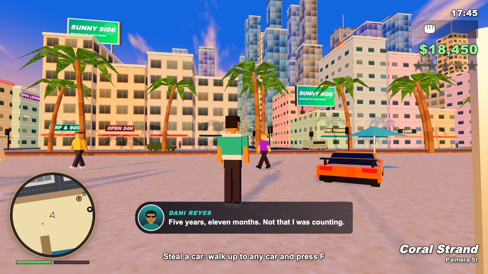

# Solara Bay

[](https://make.fun/bounty/gta6-01) [](https://make.fun/bounty/gta6-01/leaderboard) [](https://make.fun/bounty/gta6-01)

**Solara Bay** is an original open-world crime game set on a sun-soaked coast. It runs in desktop Chrome from plain static files, fully offline, built with three.js and procedural everything: the city, the cars, the people, the textures, the music and the sound.

Dani Reyes took a six-year fall for the Saltjaw Crew and kept quiet. Now Dani is out, the bay still glows gold at sunset, and Gideon Pike, the man who sold Dani out, runs the waterfront. Auntie Coco has work, Tavo has wheels, and there is a score to settle.



## What's in it

- **A whole city.** Seven districts on a 10 × 10 street grid: the glass towers of Vista Centro, the shops of Mercado, the pastel neon of Deco Row, the villas of Palm Grove, the cranes and container stacks of Ironwake Docks, the Coral Strand beach with its pier and the Sol Wheel, and Gull Key's lighthouse across the cable-stayed Causeway Bridge.
- **Golden hour and night.** A 24-hour day/night cycle with a shader sky, clouds and stars, sun shadows, a shader ocean with sun glitter, lit windows, neon signs, street lamps and their light pools, and headlights after dark.
- **On foot and by car.** A third-person camera with mouse look, jogging, sprinting and jumping. Walk up to any car and press F to drag the driver out. Seven vehicles handle differently (Mirela Sedan, Vantor RS, Haulden Ranchero, Cruzer Interceptor, Solcab Taxi, Tessaro Shuttle, Zipline 600), with arcade physics, handbrake drifts, tyre smoke and skid marks, damage, smoke, fire and explosions.
- **A living street.** Traffic follows right-hand lanes, stops at red lights and behind other cars, honks, and panics after a crash. Pedestrians walk the sidewalks, cross at corners, run from gunfire, and sometimes fight back.
- **Bay Police.** One to five wanted stars. Crimes add heat and witnessed crimes count for more. Cruisers route through the grid and ram. Officers arrest you at one star and shoot from two. Roadblocks appear at three stars and a helicopter with a searchlight at four. The stars flash and fade once nobody can see you. You can end up BUSTED or WASTED, with respawns at the station or the hospital.
- **Combat.** Fists, the Kobra 9 pistol, the Rattler SMG and the Breaker 12 shotgun, with muzzle flash, tracers, sparks, blood, health and armour.
- **Story.** Six missions with distinct goals and dialogue cut-ins: *Homecoming*, *Showroom Special* (deliver a car undamaged), *Heat Wave* (lose three stars), *Tail Lights* (chase down a courier), *Ironwake Reckoning* (take out a gang) and *Sunset Run* (a timed race to a boss fight).
- **Side activities.** Solcab taxi fares, Coco's Taco Run deliveries, 25 hidden Sun Medallions, Bayside Arms (guns, ammo, armour), Tavo's Respray, and pickups around the city.
- **HUD.** A rotating circular minimap with a GPS route and blips, health and armour bars, wanted stars, cash, weapon and ammo, a clock, the area and street name, a speedometer, objectives, mission timers and radio station toasts.
- **Menus.** A title screen with a story intro and a pause menu with a full city map (click to set a waypoint), a mission brief and stats, settings and controls. Progress saves to localStorage.
- **Sound.** Four procedural radio stations (Sunwave 101.7, Bayside Bass 94.3, Radio Tropicana 88.9 and Low Tide 106.1), plus engine notes, sirens, the helicopter, surf, gunshots, crashes and explosions, all synthesised with Web Audio.

## Controls

| Key | Action |
| --- | --- |
| W A S D | Walk / drive |
| Mouse | Look around (click to capture the mouse) |
| Shift | Sprint |
| Space | Jump · handbrake drift |
| F | Steal / enter / exit a car |
| Left click / right click | Shoot or punch / aim |
| 1–4, mouse wheel, Q | Switch weapon |
| R | Reload · next radio station (in a car) |
| H | Horn |
| E | Interact (shops, save, taco run) · police siren |
| T | Taxi fares in a Solcab |
| C | Look behind |
| M | City map |
| Esc / P | Pause |

## Run it

```sh
node serve.ts
```

Then open http://localhost:8080 in desktop Chrome. Any static file server pointed at `game/` works too: the game needs no build step and makes no network requests.

Developer extras:
- `?shot=cover|drive|police|mission&seed=1` stages the screenshot scenes from the real game code.
- `?selftest=1` plays through every system in fast-forward and reports each step.

To hand the entry in, run `mkdir -p out && MAKEFUN_OUTPUT_DIR=out node main.ts`.

## Code layout

```
game/index.html            page, HUD markup, menus
game/src/main.js           boot, game context, fixed-step main loop
game/src/core/             input, events, seeded random, saves, geometry builder
game/src/world/            city layout, road network, textures, buildings, landmarks, props, water, sky, day/night
game/src/vehicles/         vehicle types, procedural models, arcade physics, vehicle manager
game/src/characters/       human model and body, player controller, pedestrians
game/src/ai/               traffic, police, wanted level, gang AI, shared gunfight brain, route driver
game/src/combat/           weapons, hitscan combat and explosions, particle effects
game/src/missions/         cast, mission framework, story missions, side jobs, collectibles
game/src/gameplay/         session (save, wasted/busted), pickups, shops, GPS, markers
game/src/ui/               HUD, minimap, map renderer, city map, dialogue, menus, styles
game/src/audio/            audio engine, synth voices, sound effects, procedural radio
game/src/camera/           third-person follow camera
game/src/shots/            screenshot scenes and the self-test
```

Everything in the game is original. The only third-party code is three.js (MIT), vendored as `game/vendor/three.module.min.js`.
