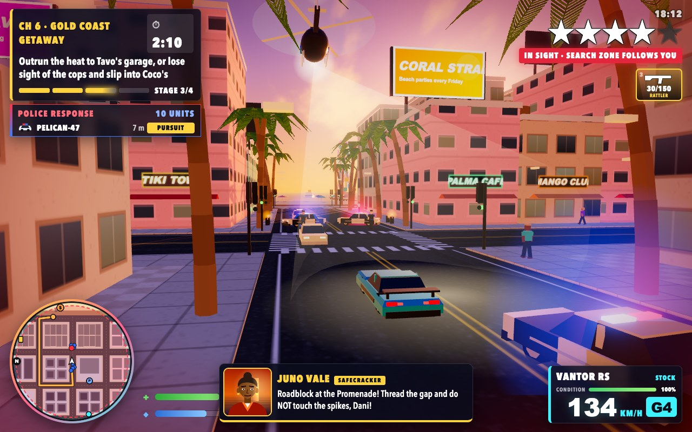
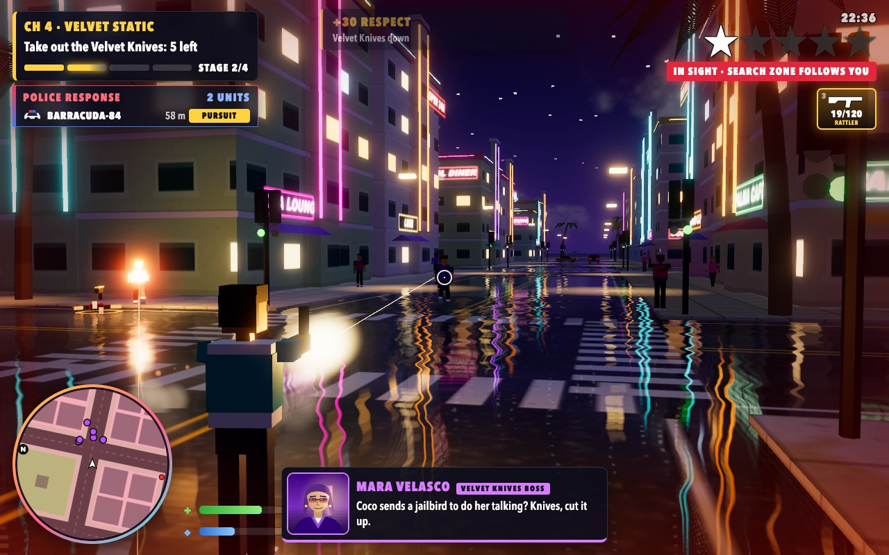
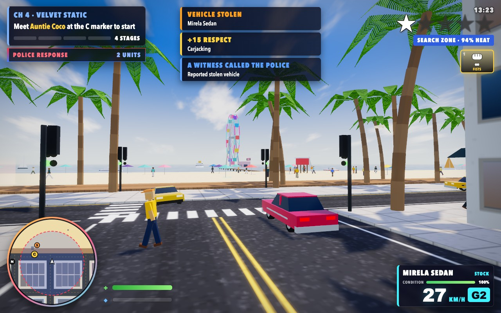
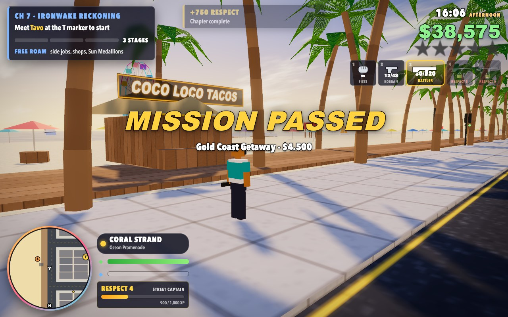

# Solara Bay

[](https://make.fun/bounty/gta6-01) [](https://make.fun/bounty/gta6-01/leaderboard) [](https://make.fun/bounty/gta6-01)

**Solara Bay** is an original open-world crime game set on a sun-soaked coast. It runs in desktop Chrome from plain static files, fully offline, built with three.js and procedural everything: the city, the cars, the people, the textures, the music and the sound.

Dani Reyes took a six-year fall for the Saltjaw Crew and kept quiet. Now Dani is out, the bay still glows gold at sunset, and Gideon Pike, the man who sold Dani out, runs the waterfront. Auntie Coco has work, Tavo has wheels, Juno can open any safe, and Mara Velasco's Velvet Knives own the neon of Deco Row.



| | | |
| --- | --- | --- |
|  |  |  |

## What's in it

- **A whole city.** Nine districts on a 10 × 10 street grid, each with its own character on the HUD: the glass towers of Vista Centro, the markets of Mercado, the pastel neon of Deco Row, the villas of Palm Grove, the cranes of Ironwake Docks, Lumen Park, the Coral Strand beach with its pier and the Sol Wheel, and Gull Key's lighthouse across the cable-stayed Causeway Bridge. Palmera St, Causeway Blvd and Ocean Promenade are royal-palm boulevards.
- **Golden hour, neon nights.** A 24-hour cycle with a shader sky, clouds and stars, sun shadows and a glittering ocean, lit windows, neon signs and street lamps. An HDR bloom pipeline makes the sun, neon, headlights and light bars glow, and after dark the streets turn rain-slick and mirror the city in real planar reflections.
- **On foot and by car.** A third-person camera with mouse look, sprinting and jumping. Behind the wheel the chase camera keeps the car low in the frame with the road opening up ahead, widens only a few degrees with speed, and swings back behind the bonnet once the mouse rests (behind the boot only when reversing for real, not on a tap of S). Walk up to any car and press F to drag the driver out, or bail out of a moving one. Eight vehicles handle differently (Mirela Sedan, Vantor RS, Haulden Ranchero, Cruzer Interceptor, Solcab Taxi, Tessaro Shuttle, Bastion Armored, Zipline 600), with handbrake drifts, tyre smoke, skid marks, damage, fire and explosions.
- **A living street.** Traffic keeps its lanes, stops at red lights and honks. Pedestrians walk, cross, run from gunfire, sometimes fight back, and pull out a phone when they see a crime: if the witness is still standing a few seconds later, the police get the call.
- **The Bay Police.** One to five stars. Every unit has a call sign, and the police-response panel lists what each is doing (RAMMING, PURSUIT, FIRING, ON FOOT, ROADBLOCK, SPOTLIGHT). Cruisers route through the grid and ram, officers arrest and shoot, the GULL ONE helicopter sweeps a searchlight from three stars, and at four dispatch parks roadblocks with spike strips across the road ahead. Break line of sight and the search zone on the minimap starts to cool. BUSTED and WASTED respawn you at the station or the hospital.
- **Combat.** Fists, the Kobra 9 pistol, the Rattler SMG, the Breaker 12 shotgun and the Longreach AR, with muzzle flash, tracers, sparks, health and armour.
- **Story.** Eight chapters with stages, timers and voiced-style dialogue with painted portraits: *Homecoming*, *Showroom Special*, *Heat Wave*, *Velvet Static* (a neon night shootout with the Velvet Knives and their boss), *Tail Lights*, *Gold Coast Getaway* (an armored-truck heist and a four-star escape that ends at Tavo's garage, which takes Dani in under fire, or at Coco's side door a block away, which only opens once no unit can see Dani and costs a cut; Tavo remembers which), *Ironwake Reckoning* and *Sunset Run*.
- **Progression.** Respect from chapters, side jobs, carjackings, escapes and crew fights climbs six ranks, from Fresh Out to Golden Coast Legend, unlocking guns at Bayside Arms and upgrade tiers at Tavo's Chrome & Paint: repairs, a respray that loses the heat, engine tunes, armour plating and race brakes, each previewed on stat bars. An upgraded car becomes Dani's own and is saved.
- **Side activities.** Solcab taxi fares, Coco's Taco Run deliveries, and the timed Promenade Sprint: bring a working car to the cyan R marker on Ocean Promenade, press E, then clear all five waterfront checkpoints in order for $900 and respect. Also: 25 hidden Sun Medallions, rival crew turf, the safehouse save point and pickups around the city.
- **HUD.** A mission card with chapter, timer, objective, STAGE n/m and what is NEXT; the police-response panel; cash, clock and wanted stars with IN SIGHT / SEARCH ZONE; a five-slot weapon bar with ammo and respect locks; a rotating minimap with GPS route, blips and the police search circle; the district pill; health, armour and respect bars; a radio card with song and artist; a vehicle card with condition, speed and gear; toasts and dialogue. When a pursuit starts, secondary free-roam details collapse while the nearest real dispatch unit stays visible with its call sign, live status and range.
- **Menus and saves.** A title screen with a story intro, and a pause menu with the city map (click to set a waypoint), the chapter brief and stats, settings and controls. Progress saves to localStorage.
- **Sound.** Four procedural radio stations with original song titles (Sunwave 101.7, Bayside Bass 94.3, Radio Tropicana 88.9, Low Tide 106.1), plus engines, sirens, the helicopter, surf, gunfire, crashes and explosions, all synthesised with Web Audio.

## Controls

| Key | Action |
| --- | --- |
| W A S D | Walk / drive |
| Mouse | Look around (click to capture the mouse) |
| Shift | Sprint |
| Space | Jump · handbrake drift |
| F | Steal / enter / exit a car (bail out at speed) |
| Left click / right click | Shoot or punch / aim |
| 1–5, mouse wheel, Q | Switch weapon |
| R | Reload · next radio station (in a car) |
| H | Horn |
| E | Interact: shops, garage, save, taco run, street sprint · police siren |
| T | Taxi fares in a Solcab |
| C | Look behind |
| M | City map |
| Esc / P | Pause |

In Tavo's garage: W / S choose, E buys, Esc drives out.

## Run it

```sh
node serve.ts
```

Then open http://localhost:8080 in desktop Chrome. Any static file server pointed at `game/` works too: the game needs no build step and makes no network requests.

Developer extras:
- The four screenshots are unedited 1280 × 800 playable Chrome captures of the deterministic scenes listed in `shots.json`.
- `?shot=cover|race|neon|payoff&seed=1` stages four posed scenes from the game code, kept as a development aid.
- `?selftest=1` plays through every system in fast-forward and reports each step, both Gold Coast drops included.
- `node --test tests/*.test.mjs` checks the chase camera's framing (car placement, field of view, look-ahead, recentre rules).

To hand the entry in, run `mkdir -p out && MAKEFUN_OUTPUT_DIR=out node main.ts`.

## Code layout

```
game/index.html            the page: canvas, UI root, import map
game/src/main.js           boot, game context, fixed-step main loop
game/src/core/             input, events, seeded random, saves, geometry builder
game/src/world/            city layout, districts, road network, boulevards, buildings, landmarks, props, water, sky, day/night
game/src/render/           HDR bloom and colour grade, wet-road reflections
game/src/vehicles/         vehicle types, procedural models, arcade physics, vehicle manager
game/src/characters/       human model and body, player controller, pedestrians
game/src/ai/               traffic, shared gunfight brain, route driver
game/src/police/           wanted level, police force, pursuit driving, officers, helicopter, roadblocks, dispatch, witnesses
game/src/gangs/            rival crews, gang members, territory
game/src/missions/         cast, mission framework, the eight chapters, side jobs, collectibles
game/src/progression/      respect ranks
game/src/shops/            gun store, garage upgrades, safehouse
game/src/gameplay/         session (save, wasted/busted), pickups, GPS, markers
game/src/ui/               HUD and its cards, minimap, map, dialogue, portraits, garage menu, menus, styles
game/src/audio/            audio engine, synth voices, sound effects, procedural radio
game/src/camera/           third-person follow camera and the chase framing math
game/src/shots/            posed scenes and the self-test
tests/                     chase-camera framing test (node --test)
```

Everything in the game is original. The only third-party code is three.js (MIT), vendored as `game/vendor/three.module.min.js`.
